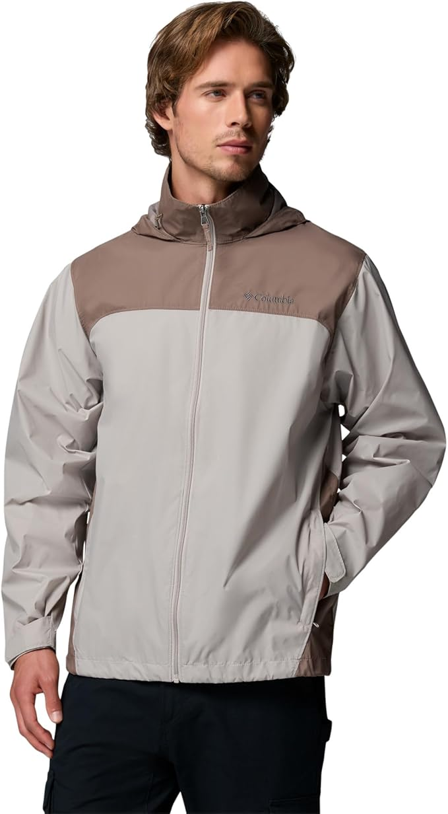
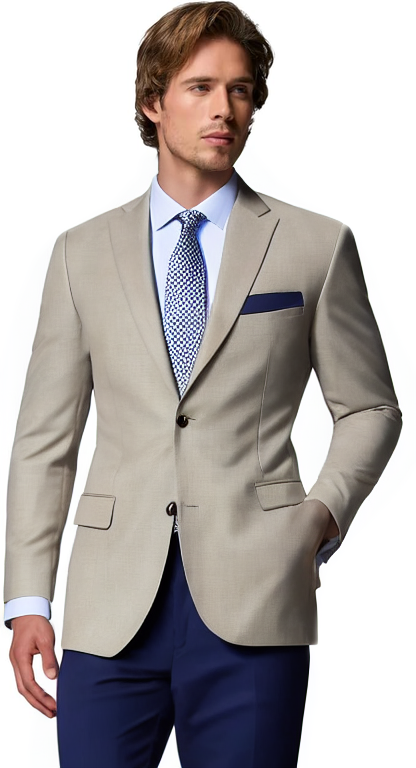

# StyleForge AI

**Virtual outfit generation with pose control and identity conditioning.**


Turn a reference photo, occasion, style, and color palette into a new outfit. StyleForge AI combines Stable Diffusion, ControlNet, IP-Adapter, and clothing segmentation in a Streamlit interface.

[Output preview](#output-preview) · [Features](#features) · [Quick start](#quick-start) · [Usage](#usage) · [Evaluation](#evaluation) · [Documentation](#documentation)

## Output preview

### Clothing replacement

A saved inpainting result: the reference jacket is replaced with a suit while retaining much of the subject's pose and appearance.

| Reference photo | Generated outfit |
|:---:|:---:|
|  |  |

[View the reference](test_images/m2.jpg) · [View the full output](examples/outfit-reconstruction.png)

## Features

- **Clothing replacement:** Segformer identifies clothing regions for Stable Diffusion inpainting.
- **Pose and identity guidance:** OpenPose ControlNet and IP-Adapter condition generation on the reference photo.
- **Structured prompts:** Occasion, style, and color choices become detailed garment descriptions.
- **Prompt comparison:** Compare baseline and structured prompts using the same seed.
- **Evaluation:** Inspect prompt alignment, identity similarity, image quality, consistency, and diversity.

## Quick start

### Requirements

- Python 3.9 or later.
- An Apple Silicon or CUDA-capable GPU is recommended; CPU execution is supported but slower.
- Disk space for model weights, which download on first use.

### Installation

```bash
git clone https://github.com/sayushmaharjan/styleforge-ai.git
cd styleforge-ai
python -m venv .venv
source .venv/bin/activate
pip install -r requirements.txt
streamlit run app.py
```

On Windows, activate the environment with `.venv\Scripts\activate`.

Open `http://localhost:8501`, upload a reference photo, select an occasion and style, and choose a generation mode.

## Usage

### Generation modes

| Mode | Purpose |
|---|---|
| Inpaint | Replace clothing within a segmentation mask. |
| ControlNet + IP-Adapter | Generate an outfit guided by the reference pose and identity. |
| Comparison | Compare baseline and structured prompts side by side. |

### Run the included example

```bash
python run_example.py
```

The example uses `test_images/m2.jpg` and writes generated images and masks under `output_images/`.

### Prompt design

| Strategy | Example |
|---|---|
| Baseline | A person wearing formal clothes for a wedding. |
| Structured | A full-body photo of a person wearing a tailored navy suit, white dress shirt, silk tie, and polished shoes, suitable for a wedding. |

Structured prompts specify clothing, setting, and styling more explicitly. Use the comparison mode to inspect how those choices affect a particular reference image.

## How it works

```text
Reference photo + occasion + style + colors
    |
    +-- Clothing segmentation --> Inpainting
    |
    +-- Pose extraction + identity conditioning --> Image generation
    |
    +-- Generated outfits --> Evaluation and comparison
```

| Component | Implementation |
|---|---|
| Image generation | Stable Diffusion 1.5 and Diffusers |
| Pose guidance | OpenPose ControlNet |
| Identity guidance | IP-Adapter |
| Clothing masks | Segformer |
| Interface | Streamlit |

## Evaluation

After generating an image with the example script, run:

```bash
python eval_example.py
```

The evaluator compares the saved reconstruction with the reference and reports prompt alignment, identity similarity, visual quality, and SSIM. The Streamlit comparison mode also exposes consistency and diversity metrics.

The following scores were documented for the reconstruction example; they describe one sample, not a general benchmark.

| Metric | Recorded score |
|---|---:|
| Prompt alignment (CLIP) | 0.6417 |
| Identity preservation | 0.8612 |
| Visual quality | 0.8489 |
| Structural similarity (SSIM) | 0.7973 |

## Documentation

- [Technical documentation](DOCUMENTATION.md): architecture, prompting, evaluation methods, limitations, and failure cases.
- [Configuration](config.py): model identifiers, generation parameters, and device selection.
- [Dependencies](requirements.txt).
